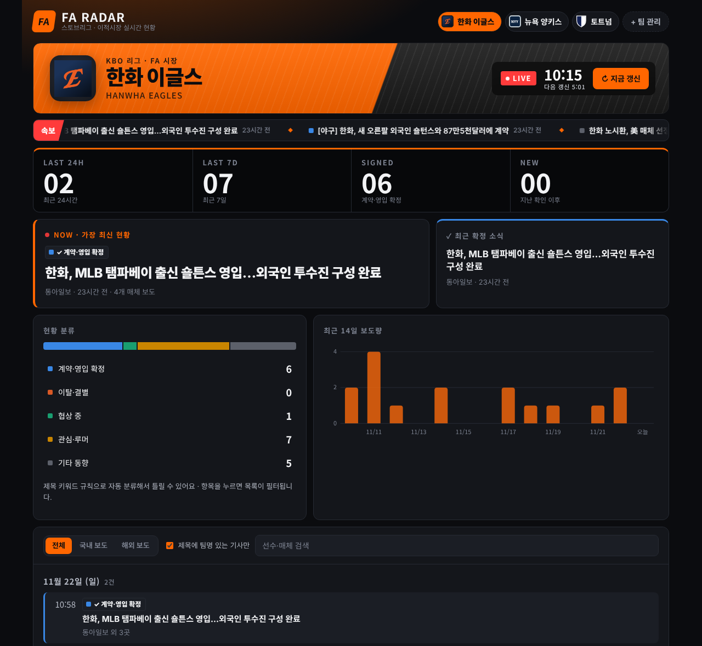
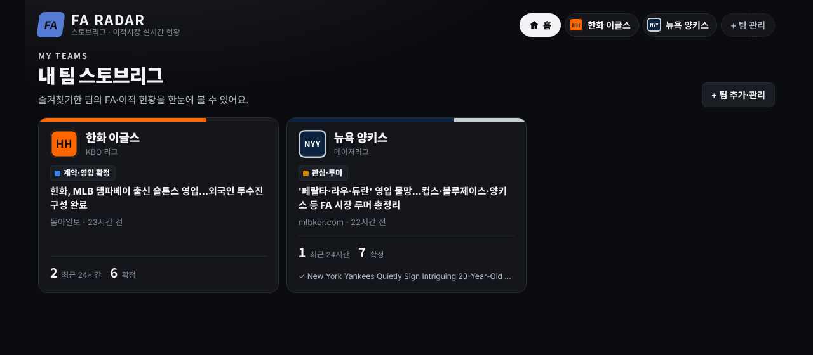
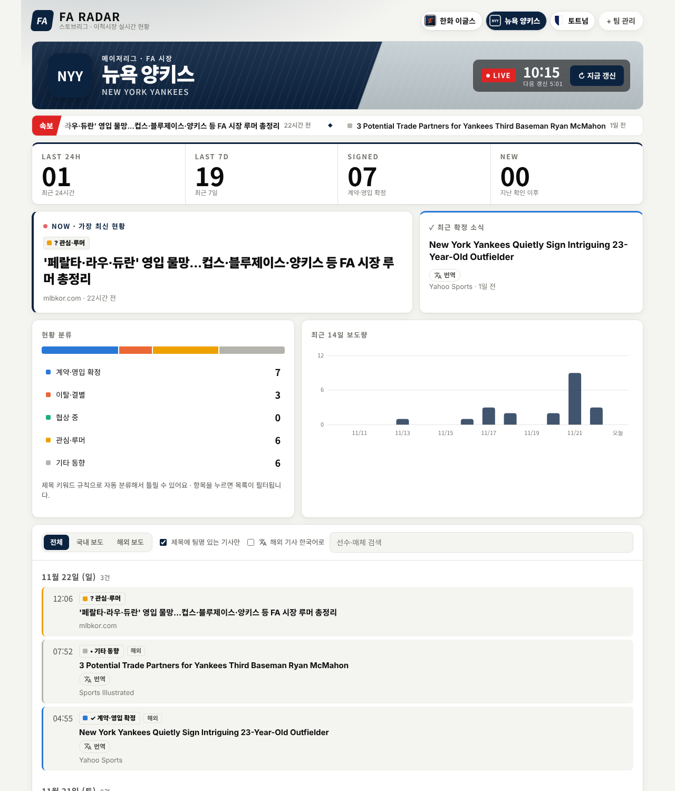
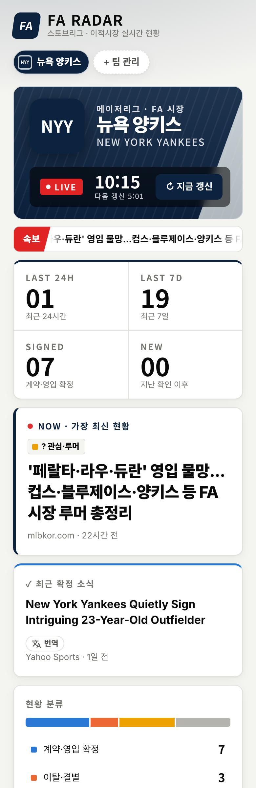
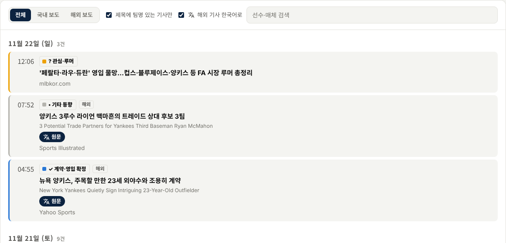
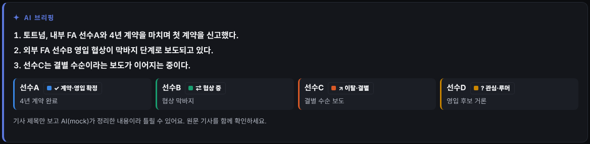

# ⚾⚽ FA 레이더 — 내 팀 스토브리그를 가장 빠르게

> 응원팀을 고르면 그 팀의 **FA·이적 뉴스를 모아, 지금 무슨 일이 일어나고 있는지** 한 화면에 정리해 주는 대시보드

**🔗 서비스:** `배포 주소를 여기에` · **📁 코드:** [`FA_Dashboard/`](FA_Dashboard) · **🛠 개발 문서:** [FA_Dashboard/README.md](FA_Dashboard/README.md)

---

## 1. 문제

스토브리그(겨울 이적 시장)에는 하루에도 응원팀 기사가 수십 건씩 쏟아집니다.

- **같은 소식이 매체마다 반복**돼요. 한화의 외국인 투수 영입 하나에 기사가 6건씩 나와요.
- **확정인지 루머인지 구분하기 어려워요.** "영입 접근 가능성 제기", "사올까?" 같은 제목이 대부분이에요.
- **MLB·해외축구는 영문 기사가 먼저** 나오는데, 국내 보도는 늦거나 일부만 다뤄요.
- 포털 검색으로는 **"그래서 지금 우리 팀 상황이 어떤데?"**에 바로 답을 얻기 어려워요.

## 2. 대상 사용자와 핵심 질문

| 사용자 | 알고 싶은 것 |
|---|---|
| KBO·MLB·해외축구 응원팀이 있는 팬 | 오늘 확정된 계약이 있나? 누가 떠나나? 어떤 선수와 협상 중인가? |

그래서 화면의 첫 질문을 **"가장 최신 현황"**과 **"최근 확정 소식"**으로 정했고, 나머지 정보(분류, 보도량, 타임라인)는 그 아래에 두었습니다.

## 3. 핵심 기능

| 기능 | 설명 |
|---|---|
| 홈 · 팀 선택 | KBO 10팀, MLB 30팀, 5대 리그 54팀. 즐겨찾기한 팀 전체를 **홈에서 한눈에** 보고, 팀별 화면은 주소(`?team=`)로 공유 가능 |
| 현황 분류 | 기사를 **확정 / 이탈 / 협상 / 루머 / 기타**로 자동 분류하고 필터링. 다른 팀의 계약은 **"다른 팀 계약"**으로 따로 표시 |
| 같은 소식 묶기 | 같은 소식을 쓴 여러 매체 기사를 하나로 묶고 "n개 매체 보도"로 표시 |
| MLB 전문 소스 | Google News에 더해 **MLB Trade Rumors** 팀별 피드로 영입·방출·논텐더 소식 보강 |
| 해외 기사 번역 | 영문 제목 옆 번역 버튼, 해외 기사 전체를 한국어로 보는 토글 |
| AI 브리핑 (선택) | API 키가 있으면 **3줄 요약 + 선수별 현황판 + AI 재분류** |
| 자동 갱신 | 5분마다 새로 받아오고, 지난번 확인 이후 새 기사에 NEW 표시 |
| 팀 테마 | 팀 대표색으로 배너·강조 색 전환, 라이트/다크 모드 자동 전환 |

## 4. 기획 결정과 근거

### ① 데이터: 유료 API 대신 공개 RSS
- 스포츠 뉴스 API는 대부분 유료이거나 국내 매체 범위가 좁아요. 그래서 **Google News RSS 검색**으로 국내·해외 매체를 함께 받는 방식을 택했어요. API 키도 비용도 들지 않아요.
- MLB는 국내 보도만으로 부족하다는 피드백을 받았어요. 그래서 MLB 이적 소식을 가장 빠르게 다루는 **MLB Trade Rumors**의 팀별 피드를 추가했어요. 30개 팀 피드가 모두 열리는 것도 확인했어요.
- 국내 매체는 "LA 다저스"보다 **"다저스"**, "맨체스터 유나이티드"보다 **"맨유"**라고 더 많이 써요. 그래서 팀 정식 이름과 한글 줄임말을 함께 검색해요.

### ② 실제 데이터에서 발견한 문제 → 해결
실제 기사를 받아 직접 확인하면서 처음 설계에서 놓친 문제를 찾았어요.

| 발견한 문제 | 해결 |
|---|---|
| "한화"로 검색하면 **한화오션·한화에어로스페이스** 같은 계열사 경제 기사가 섞임 | 검색어에 야구 문맥 단어를 추가해 74건 중 경제 기사를 1건으로 줄이고, 남은 계열사·e스포츠 기사는 필터로 제외 |
| 제목 끝에 "머니투데이 - 머니투데이"처럼 매체명이 반복되거나 주소가 붙음 | 매체명 정리 로직 추가 (테스트 포함) |
| 같은 영입 소식이 매체별로 6건씩 나열됨 | 36시간 안에 나온, 같은 상태의, 같은 선수 이름이 들어간 기사를 하나로 묶음 |
| 다저스 화면에 "스쿠벌, **메츠와** 계약"이 뜨면 우리 팀 영입처럼 보이고 확정 숫자도 부풀려짐 | 계약 상대 팀을 읽어 **다른 팀 계약**으로 구분하고 확정 숫자에서 제외 (팀 입장 판단 테스트 18건) |
| "계약 체결: 다음은?"처럼 뒤에 물음 문장이 붙으면 확정 기사가 루머로 내려감 | 문장 단위로 판단하도록 수정 |

### ③ 분류: 규칙 → 측정 → 한계 확인 → AI 선택 기능
처음에는 제목 키워드 규칙으로 분류했어요. **실제 기사 156건에 직접 정답을 달고** 정확도를 쟀어요.

| 데이터 | 처음 규칙 | 개선 규칙 |
|---|---|---|
| 규칙을 다듬을 때 쓴 기사 94건 | 39% | 99% |
| 다듬은 뒤 처음 본 기사 27건 | 33% | 첫 측정 56% → 일반 패턴 보강 후 96% |
| 마지막에 새로 모은 기사 35건 | 51% | **첫 측정 66%** → 공통 버그 수정 후 89% |

- 규칙을 다듬는 데 쓴 기사에서는 99%가 나왔지만, **처음 보는 기사에서는 56~66%**로 떨어졌어요. 규칙이 특정 표현에 맞춰지는 한계예요.
- 그래서 문맥을 읽는 **AI 분류를 선택 기능**으로 붙였어요. API 키만 넣으면 AI가 재분류·요약·번역을 하고, 키가 없거나 호출이 실패하면 규칙 결과를 그대로 써요.
- 위 표의 "개선 규칙" 마지막 수치는 실패 사례를 본 뒤 고친 결과라 실제보다 높게 나왔을 수 있어요. 새 기사로 계속 다시 재야 하는 숫자예요.

### ④ 번역: 비용이 들지 않는 방법부터
1. AI 브리핑이 켜져 있으면 AI가 번역한 제목을 써요.
2. 아니면 **브라우저 내장 번역**(Chrome Translator API)을 써요. 기기 안에서 무료로 번역해요.
3. 지원하지 않는 브라우저에서는 구글 번역 페이지로 연결해요.

번역 문장은 화면 예시용입니다. 실제 결과는 브라우저 번역이나 AI 번역에 따라 달라요.

### ⑤ AI 브리핑 (선택 기능)

예시 데이터로 찍은 화면입니다.

- 기사 제목 최대 40건을 한 번에 보내서 **요약·선수별 현황·재분류·번역**을 한 번의 호출로 받아요.
- 같은 기사 묶음이면 30분 동안 다시 호출하지 않고, 응답이 Vercel CDN에 5분 캐시돼서 비용이 쌓이지 않게 했어요.
- "기사 제목만 보고 정리한 내용이라 틀릴 수 있다"는 안내를 항상 함께 보여줘요.

## 5. 기술 구성

- **Next.js (App Router) + TypeScript**, Vercel 배포
- 서버: `/api/news`에서 RSS를 수집·정리하고 CDN에 캐시
- 클라이언트: 즐겨찾기·NEW 표시는 브라우저 저장소에 저장, 5분마다 자동 갱신
- 테스트: RSS 파싱, AI 응답 해석, 분류 정확도 (`npm test`)

## 6. 한계와 다음 단계

- **제목만 보고 판단해요.** 본문을 읽으면 정확도가 오르지만, 저작권과 수집 부담 때문에 제목·링크만 써요.
- **분류 정확도를 계속 재야 해요.** 정답 데이터를 주기적으로 늘려서 규칙과 AI의 정확도를 비교할 계획이에요.
- **알림:** 응원팀에 "확정" 기사가 나오면 푸시 알림 보내기
- **선수 단위 추적:** "노시환"처럼 선수를 직접 팔로우하는 기능
- **로고:** 구단 로고는 상표라서, 공개 서비스에서는 사용 범위를 확인해야 해요.
